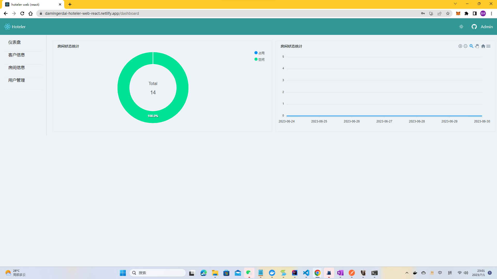

# Hoteler Web React

This project is the [react](https://reactjs.org/) implement of [hoteler-web](https://github.com/damingerdai/hoteler-web).

The UI uses [Material UI](https://mui.com/material-ui/) (MUI 9), following [issue #326](https://github.com/damingerdai/hoteler-web-react/issues/326).

# Screensheets



# Demo

deployed by k3s: [hoteler-web-react](http://hoteler-react.damingerdai.com/)

deployed by netlify: [damingerdai-hoteler-web-react.netlify.app](https://damingerdai-hoteler-web-react.netlify.app)

## Development

Use Node.js 22.12+ (Node.js 24 recommended) and pnpm 8.15.9.

```sh
pnpm install --frozen-lockfile
pnpm dev
```

The `/api` proxy targets `http://localhost:8090` by default. Set `BASE_URL` in `.env` to use another Hoteler backend.

```sh
pnpm lint
pnpm test
pnpm build
```

## MUI migration

- Login and registration use MUI inputs with Formik/Yup validation.
- AppBar/Drawer navigation supports mobile layouts, user permissions, logout, and persistent light/dark/system mode.
- Customer and room create/edit/delete flows use Dialogs; room check-in validates dates and refreshes occupancy.
- User creation refreshes the user table. Dashboard charts retain the existing statistics endpoints.
- SWR owns server data and refreshes lists after mutations. Snackbar/Alert handle success and error feedback.
- Requests retain the existing `/api/v1` contracts and `user_token` storage. The backend must still enforce permissions.

Tests use a mocked Axios adapter to exercise UI flows and request contracts. Real backend integration and browser visual acceptance should also be checked before release. The screenshots above predate the MUI migration.
